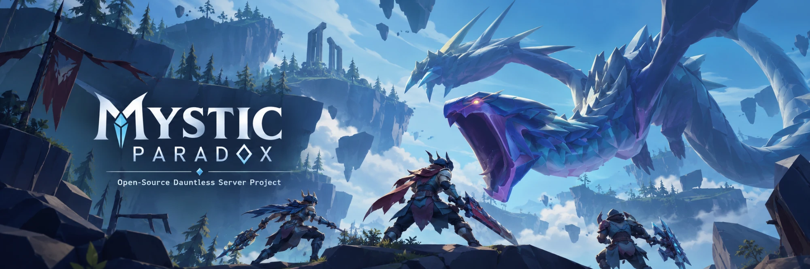

  

<h1 align="center">Mystic Paradox</h1>

  <b>Open-source private server for Dauntless</b> — play Dauntless 1.14.7 again on the official Mystic Paradox
  server, or run a server of your own.

  
  
  
  
  

  <a href="#-play-on-the-official-server">Play</a> ·
  <a href="#-whats-in-the-game">What works</a> ·
  <a href="#-host-your-own-server">Host your own</a> ·
  <a href="#-documentation">Docs</a> ·
  <a href="docs/FAQ.md">FAQ</a> ·
  <a href="#-community-and-help">Community</a>

  <table>
    <tr>
      <td align="center" width="680">
         
        
        <h2>Join the Mystic Paradox Discord</h2>
        
Server news and updates, help with the launcher, and other Slayers to hunt with.

        
          
      </td>
    </tr>
  </table>

> [!IMPORTANT]
> Unofficial and community-developed. Not affiliated with, endorsed by, or sponsored by Phoenix Labs,
> Epic Games, Forte Labs, or any current or former Dauntless rights holder. This repository ships
> **source code only** — no game files, SDK or game data.

## 🎮 Play on the official server

1. **Install Dauntless 1.14.7** from Epic with your own account — [Installing Dauntless](docs/INSTALLING_DAUNTLESS.md).
2. **Download the Mystic Paradox launcher** from the [Releases](https://github.com/pranav158/Mystic-Paradox/releases)
   page and install it. It keeps itself and the game's runtime up to date.
3. **Create your account** in the launcher, with an email and a password or through Discord.
4. **Point the launcher at your Dauntless folder and press Play.**

Questions, news and help are on our [Discord server](https://discord.gg/e3HuAZGdU3).

## ✨ What's in the game

- **Ramsgate and the Training Grounds**, hunts across the Shattered Isles, **Escalations**, **Trials** and **the Gauntlet**.
- **Parties, friends and chat.**
- **Saved progress:** loot, XP, weapon levels, reforge, mastery and bounties.
- **Paradox realms:** every hub and hunt on the official server is hosted on a player's PC and joined through
  **Mystic Relay**, so the game does not depend on rented game servers. A self-hosted server can run realms too, or
  classic dedicated hubs and hunts.

| Game version | State |
|---|---|
| **Dauntless 1.14.7** (CL `647472`) | ✅ **Live** on the official server; `main` targets 1.14.7 — [progress notes](docs/DAUNTLESS_1_14_7_PORT.md) · [co-op and realms](docs/SELF_HOSTING.md#co-op-hunts-and-paradox-realms) |
| **Dauntless 1.12.0** (CL `392819`) | 🗄️ Legacy, no longer updated — build it from the [`dauntless-1.12.0`](https://github.com/pranav158/Mystic-Paradox/tree/dauntless-1.12.0) tag |

The official server runs a newer build than `main`: its code is published here in stages, so some of what you
play may not be in this repository yet.

## 🏠 Host your own server

Run Mystic Paradox for yourself and your friends, from source:

1. **Read the [FAQ](docs/FAQ.md)** — what the project is, what it isn't, and where to get help.
2. **Install Dauntless 1.14.7** from Epic with your own account — [Installing Dauntless](docs/INSTALLING_DAUNTLESS.md).
3. **Generate the SDK** from your own 1.14.7 install — [Generating the SDK](docs/GENERATING_SDK.md).
4. **Generate the game data** from the same install — [Generating game data](docs/GENERATING_GAME_DATA.md).
5. **Deploy and play** — [Self-hosting](docs/SELF_HOSTING.md) walks from source to Ramsgate:
   prerequisites, DNS/TLS, services, launcher and the first acceptance test.

## 📚 Documentation

| Guide | What's inside |
|---|---|
| 🎮 [Installing Dauntless](docs/INSTALLING_DAUNTLESS.md) | Getting the 1.14.7 client from Epic with your own account and Legendary |
| 🏠 [Self-hosting](docs/SELF_HOSTING.md) | Full deployment: prerequisites, configuration helper, ports, validation, troubleshooting |
| 🧩 [Generating the SDK](docs/GENERATING_SDK.md) | Dumping the Unreal SDK with Dumper-7 and building the C++ projects |
| 📦 [Generating game data](docs/GENERATING_GAME_DATA.md) | Exporting the catalogue and tables from your install |
| 🔭 [1.14.7 port](docs/DAUNTLESS_1_14_7_PORT.md) | How the final game release was ported, and what changed along the way |
| ❓ [FAQ](docs/FAQ.md) | Common questions, support and contact |
| ⚖️ [Scope and legal](docs/SCOPE_AND_LEGAL.md) | What isn't included, responsible use, license details |
| 🔒 [Security](SECURITY.md) | Safe configuration and how to report a vulnerability |
| 🖥️ [Launcher](ParadoxLauncher/README.md) · [Update channel](ParadoxLauncher/UPDATE_CHANNEL.md) | Building, signing and publishing the launcher and runtime |

## 🗂️ Repository layout

| Folder | What it is |
|---|---|
| [`ParadoxBackend`](ParadoxBackend) | Account and metagame backend (login, characters, inventory, progression, store, party, co-op hunts, Paradox realms…) — Node/TypeScript + MongoDB (or SQLite for a local realm) |
| [`ParadoxDirector`](ParadoxDirector) | Starts and supervises dedicated game servers for hubs and hunts on a self-hosted server |
| [`ParadoxRuntime`](ParadoxRuntime) | C++ DLL loaded into the client and servers to adapt them to the private backend (MSVC + MinHook) |
| [`ParadoxLauncher`](ParadoxLauncher) | Windows launcher: sign-in, servers and realms, install checks, signed runtime updates, game sessions, realm hosting (Tauri) |
| [`ParadoxTransport`](ParadoxTransport) | Co-op transport module: ICE connections with STUN/TURN relays (libjuice) for player-hosted hubs and hunts; Mystic Relay on the official server |
| [`shared/hunt-manifest`](shared/hunt-manifest) | Hunt manifest resolution shared by the backend and the Director |
| [`tools/RuntimeLoader`](tools/RuntimeLoader) | `winmm.dll` proxy that loads the runtime at startup |
| [`tools/CatalogExporter`](tools/CatalogExporter) | Exports compatibility data from your own installation |

## 💬 Community and help

- 💬 **Discord:** [join our server](https://discord.gg/e3HuAZGdU3) for help, announcements and news. You can also
  add the maintainer, **`uwumystic`**; please include a short note with your friend request explaining why you're
  reaching out, so project requests don't get lost among unrelated ones.
- 🐛 **Bugs and feature requests:** open a [GitHub issue](../../issues). Include the component, commit,
  configuration with secrets removed, reproduction steps and logs.
- 🔒 **Security problems:** report them privately — see [SECURITY.md](SECURITY.md).

Pull requests are welcome. Never submit game files, leaked source or secrets. Project support is not
provided on Reddit.

## 📜 License and credits

[AGPL-3.0-only](LICENSE), with additional terms in [ADDITIONAL_TERMS.md](ADDITIONAL_TERMS.md) — details in
[Scope and legal](docs/SCOPE_AND_LEGAL.md).

- Based on **[Undaunted](https://github.com/SyST3MDeV/Undaunted)** by gwog / Gregory Morford (AGPLv3).
- **Mystic Paradox** is a separate community project with substantial independent changes, maintained
  by **Mystic / Pranav Karande**.
- Development assistance: [Claude](https://www.anthropic.com/claude) (Anthropic).

Full provenance in [NOTICE.md](NOTICE.md).

Made by the community, for the Slayers who aren't ready to say goodbye. 🗡️

